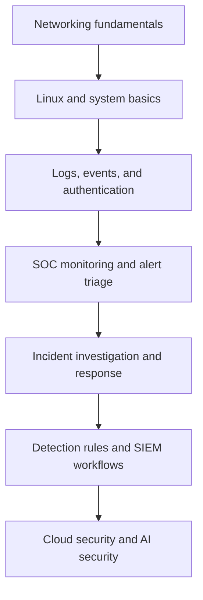

<div align="center">

# Hi, I'm Niharika P 👋

### Aspiring SOC Analyst | Cybersecurity Graduate

**Interested in security monitoring, threat detection, incident triage, and defensive security.**

[](https://github.com/niharika30p-coder)
[](https://linkedin.com/in/niharika-p-50353a255)
[](https://tryhackme.com/p/niharika30p)
[](mailto:niharika30p@gmail.com)

📍 Kerala, India

</div>

---

## 👩‍💻 About Me

I'm a Computer Science and Engineering graduate from **APJ Abdul Kalam Technological University**, building my foundation in cybersecurity with a focus on **SOC operations and defensive security**.

I'm interested in understanding how security events are generated, investigated, prioritized, and handled. I use hands-on labs and project work to connect cybersecurity concepts with practical workflows.

- 🎯 **Career focus:** SOC Analyst and Cybersecurity Analyst opportunities
- 🛡️ **Areas of interest:** Security monitoring, alert triage, threat detection, incident response, and penetration testing fundamentals
- 🧪 **Hands-on learning:** Linux, networking, Kali Linux, and TryHackMe labs
- 🧰 **Project experience:** Suricata alert monitoring dashboard and a PDF text-analysis platform
- 📚 **Training:** Offenso Certified Cybersecurity Professional

> I'm pursuing entry-level opportunities where I can contribute, learn from experienced security teams, and continue developing practical investigation skills.

## 🧭 Career Focus

```text
Networking & Linux
       ↓
Security logs and alert fundamentals
       ↓
SOC monitoring and alert triage
       ↓
Incident investigation and response
       ↓
Detection engineering and cloud security
```

## 🛠️ Skills & Tools

*These represent my current learning and project areas; proficiency varies by tool and topic.*

| Area | Skills and tools |
|---|---|
| SOC & Defensive Security | SOC operations fundamentals, alert triage concepts, security monitoring, incident response fundamentals |
| Networking & Systems | Networking fundamentals, Linux, Kali Linux |
| Security Testing Tools | Nmap, Wireshark, Burp Suite |
| Detection & Monitoring | Suricata IDS/IPS, alert/event review |
| Programming & APIs | Python, FastAPI, API security testing fundamentals |
| Security Testing Interests | API penetration testing, Android penetration testing, Active Directory penetration testing |
| Web & AI Project Tools | Next.js, React, WebSockets, Gemini API integration |

## 🚀 Featured Projects

### 1. SENTINEL — AI-Enhanced SOC Dashboard

An academic security project designed to make **Suricata IDS/IPS alerts easier to review** through a dashboard and AI-assisted explanations.

**Technologies:** Suricata, FastAPI, Next.js/React, WebSockets, Gemini

**Project highlights**
- Uses Suricata alerts as the foundation for security-event visibility.
- Presents alert information in a dashboard-oriented interface.
- Uses a FastAPI backend and WebSockets for event delivery.
- Integrates Gemini to provide explanations that can help a learner understand alerts.

**What this project explores:** security-event visibility, alert review workflows, backend/frontend integration, and AI-assisted explanation of security alerts.

> Project note: This is a dashboard built around Suricata alert data, not a claim of deploying an enterprise SIEM.

**Repository:** Add the public repository link here when available.

---

### 2. Dynamic Text Analysis Platform

A FastAPI-based project for analyzing PDF documents through natural-language-processing workflows.

**Technologies:** Python, FastAPI, PyMuPDF, NLTK, FinBERT, BERTopic, Ollama

**Project highlights**
- Extracts text from PDF documents.
- Supports document summarization.
- Explores sentiment analysis and topic detection.
- Combines NLP components with an API-based application workflow.

**What this project explores:** document processing, API development, NLP integration, and organizing multiple analysis features in one application.

**Repository:** Add the public repository link here when available.

---

## 🧪 Hands-On Learning

I use practical labs to reinforce concepts in networking, Linux, and cybersecurity.

- **TryHackMe:** [View my profile](https://tryhackme.com/p/niharika30p)
- **Linux & networking:** Practising command-line basics, network services, ports, and troubleshooting.
- **Security tools:** Learning how tools such as Nmap, Wireshark, Burp Suite, and Suricata support security investigation and testing.
- **Lab notes:** I plan to document selected exercises with the objective, approach, observations, and lessons learned.

> Lab progress and room counts are intentionally not shown here because verified current statistics have not been provided.

## 📚 Learning Roadmap



Current priority areas:
- Strengthen networking, Linux, and log-analysis fundamentals.
- Practise investigating authentication and suspicious network activity.
- Learn SIEM concepts, alert prioritization, and incident-response workflows.
- Build repeatable, well-documented lab exercises.
- Explore Python automation and AI-assisted security analysis as supporting skills.

## 📊 GitHub Overview

<!-- These cards are generated by third-party services and may occasionally be unavailable. -->

<div align="center">

[](https://github.com/niharika30p-coder)

[](https://github.com/niharika30p-coder)

[](https://github.com/niharika30p-coder)

</div>

> GitHub charts reflect public repository/activity data and depend on third-party services. They may take time to populate or may not render during service outages. No contribution totals, language percentages, or rankings are manually claimed here.

## 🎓 Education & Training

- **B.Tech — Computer Science and Engineering**  
  APJ Abdul Kalam Technological University
- **Offenso Certified Cybersecurity Professional**  
  Cybersecurity training

*Add the issuing organization's official certificate URL or exact completion details if you want this section to link to proof.*

## 🤝 Let's Connect

I'm open to connecting with cybersecurity professionals and exploring suitable **entry-level SOC Analyst and Cybersecurity Analyst** opportunities.

- **Email:** [niharika30p@gmail.com](mailto:niharika30p@gmail.com)
- **LinkedIn:** [linkedin.com/in/niharika-p-50353a255](https://linkedin.com/in/niharika-p-50353a255)
- **TryHackMe:** [niharika30p](https://tryhackme.com/p/niharika30p)
- **GitHub:** [niharika30p-coder](https://github.com/niharika30p-coder)

---

<div align="center">

*Learning continuously. Practising deliberately. Building toward a career in cybersecurity.*

</div>
